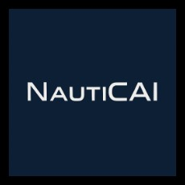
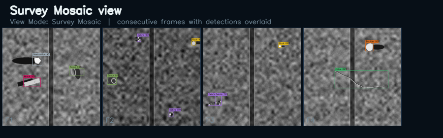
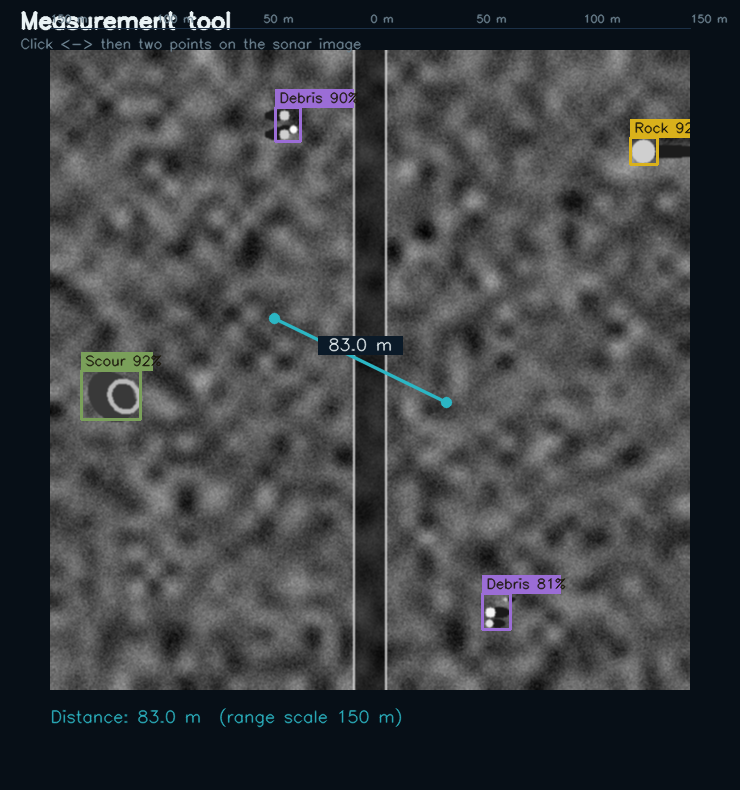
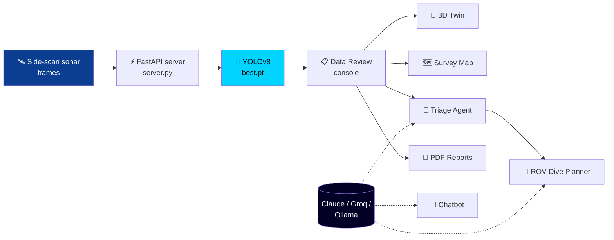

<div align="center">




<a href="https://github.com/aishwaryakam25/seabedmapping">
  
</a>

</div>

---

## 🌊 What is this?

> *More than 80% of the ocean floor is still unmapped. Every survey produces hours of sonar, and every frame has to be checked for hazards.*

**NautiCAI Seabed Mapping** turns raw **side-scan sonar** imagery into usable seabed intelligence. A YOLO model trained on sonar data finds objects on the seafloor. A web console lets surveyors review, measure and map each contact. AI agents then triage the findings and plan the ROV dives to verify them, and the results are exported as polished PDF reports.

<div align="center">

```
  🛰️ Sonar frames  ──►  🧠 YOLO detection  ──►  🗺️ Review & map  ──►  🤖 AI triage  ──►  🚤 ROV dive plan  ──►  📄 PDF report
```

</div>

---

## ✨ Features

<table>
<tr>
<td width="50%" valign="top">

### 🎯 Detection
- YOLOv8 model trained on **synthetic and real (UATD)** side-scan sonar
- **8 seabed classes** with an adjustable confidence threshold
- Batch, multi-frame upload with automatic detection

</td>
<td width="50%" valign="top">

### 🗺️ Survey review
- **Survey Mosaic** stitches frames into a single strip
- **Measurement tool** gives real distances in metres
- Adjustable **range scale** (50–300 m) and shadow-physics overlay

</td>
</tr>
<tr>
<td width="50%" valign="top">

### 🧊 3D digital twin
- Interactive **Three.js** seabed heatmap
- Contact markers with labels for every detection
- Auto-rotate camera that zooms in on detection clusters

</td>
<td width="50%" valign="top">

### 🤖 AI agents
- **Triage agent** groups contacts by recommended next action
- **ROV dive planner** orders dives and suggests tooling for each
- **Chatbot** that runs on Claude, Groq or a local **Ollama** model

</td>
</tr>
<tr>
<td colspan="2" valign="top">

### 📄 Reporting
Multi-frame **PDF survey reports** with charts, detection tables and live 3D-twin screenshots (via Playwright), plus defect reports, briefings and a mission dashboard.

</td>
</tr>
</table>

---

## 🪸 Detected classes

<div align="center">

| 🪨 `rock` | ⛰️ `boulder` | 🚢 `wreck` | 🛢️ `pipeline` |
|:---:|:---:|:---:|:---:|
| **🗑️ `debris`** | **🔌 `cable`** | **🌀 `scour`** | **⚠️ `obstruction`** |

</div>

---

## 📸 Screenshots

<div align="center">
<table>
<tr>
<td align="center"><br/><sub><b>Survey Mosaic</b></sub></td>
<td align="center"><br/><sub><b>Measurement Tool</b></sub></td>
</tr>
</table>
</div>

---

## 🏗️ Architecture



---

## 🚀 Quick start

```bash
# 1. Clone
git clone https://github.com/aishwaryakam25/seabedmapping.git
cd seabedmapping

# 2. Create a virtual environment
python -m venv .venv
.venv\Scripts\activate            # Windows
# source .venv/bin/activate       # macOS / Linux

# 3. Install dependencies
pip install -r requirements.txt
playwright install chromium       # optional: 3D-twin screenshots in PDFs

# 4. Configure (optional, for the AI agents)
copy .env.example .env            # then add your API key

# 5. Run
python server.py
```

Then open **http://127.0.0.1:8000/review** 🎉

> 💡 **Model weights:** place your trained model at `runs/detect/sonar_yolo/weights/best.pt`.
> If it's missing, the server falls back to `yolov8n.pt`, which is not trained on sonar.

> 🪟 **Windows shortcut:** double-click `start_nauticai.bat` to start Ollama and the server together.

---

## 🧭 Pages

| Route | Page | Description |
|:------|:-----|:------------|
| `/review` | 📋 Data Review | Load frames, run detection, measure, mosaic |
| `/dashboard` | 📊 Dashboard | Session summary and KPIs |
| `/map` | 🗺️ Survey Map | Geo view of all contacts |
| `/detections` | 🎯 Detections | Full contact list |
| `/twin` | 🧊 3D Twin | Interactive seabed digital twin |
| `/triage` | 🤖 Triage | AI-proposed next actions |
| `/dive-plan` | 🚤 Dive Plan | ROV mission plan with time estimates |
| `/chatbot` | 💬 Chatbot | General-purpose NautiCAI assistant |
| `/intelligence` | 🧠 Intelligence | Survey insights |
| `/reports` | 📄 Reports | PDF report generation |
| `/settings` | ⚙️ Settings | Thresholds and preferences |

---

## 🏋️ Training

```bash
# Generate synthetic side-scan frames
python make_sidescan.py --out test_frames --n 30

# Train locally
python train.py

# Fine-tune on synthetic + real UATD data
python retrain_sonar.py --epochs 20 --batch 8 --device cpu
```

Or train on a GPU with the Colab notebooks: `sidescan_train_colab.ipynb` and `uatd_train_colab.ipynb`.

---

## 🗂️ Project structure

```
seabedmapping/
├── server.py              # FastAPI backend: pages + /detect + reports
├── console.html           # Data Review: the main workflow
├── twin.html              # 3D seabed digital twin
├── agent_service.py       # LLM backend (Claude / Groq / Ollama)
├── agent_triage.py        # Triage agent
├── agent_rov.py           # ROV dive-planner agent
├── report.py              # PDF report builder
├── shadow_physics.py      # Acoustic shadow modelling
├── retrain_sonar.py       # Synthetic + UATD fine-tuning
├── make_sidescan.py       # Synthetic sonar generator
├── assets/                # Logos, theme, shared JS
└── test_*.py              # Tests
```

---

## 🧪 Tests

```bash
python -m pytest -q
```

---

<div align="center">

### 🐋 Built to make the ocean floor easier to understand

Made with 💙 by **[Aishwarya](https://github.com/aishwaryakam25)**

⭐ *Star this repo if you found it interesting!*


</div>
